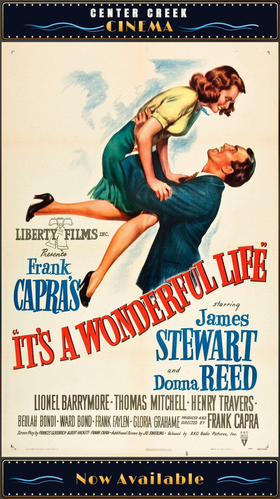
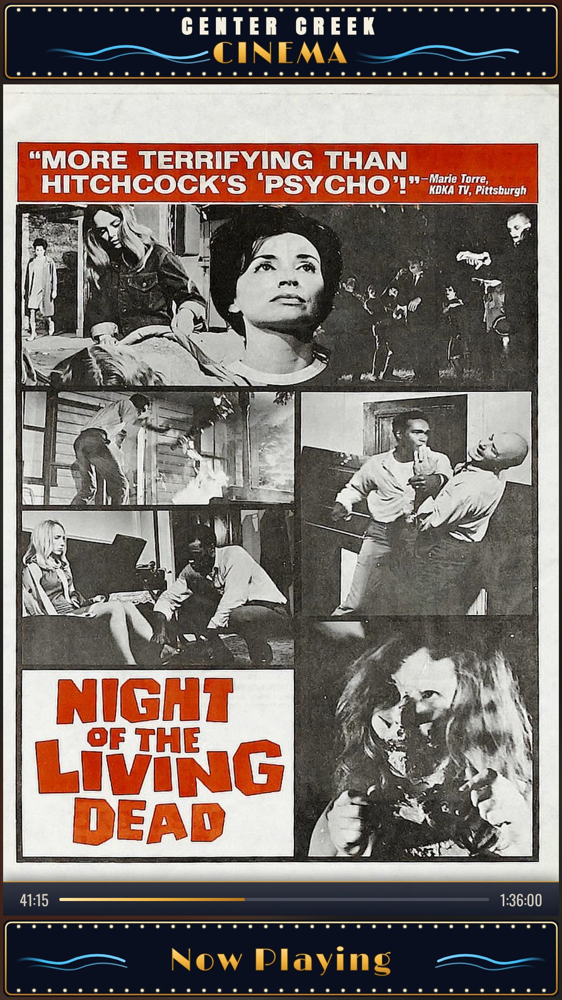
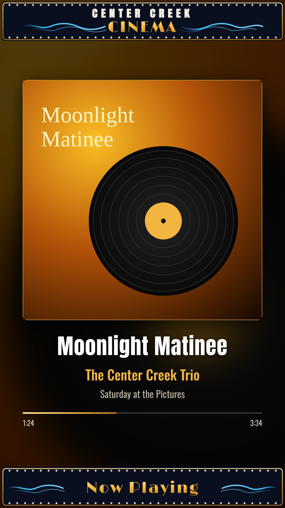

# Easy Cinema Board

A movie-theater style poster board for Home Assistant. It's built for a wall display outside a media room or home theater: a lit marquee with your theater's name, a slideshow of movie posters from your own library, Coming Soon posters with release dates, and an instant switch to **Now Playing** when a movie, show or music starts.



| Coming Soon | Movie Now Playing | Music Now Playing |
|---|---|---|
|  |  |  |

---

## ⚠️ Please read first: I'm not a developer

I'm a Home Assistant hobbyist, not a programmer. I built this card with a lot of help from Claude (Anthropic's AI assistant) because I wanted a poster display for my media room that switched to Now Playing instantly, without the page reloads and flicker workarounds I needed with other tools.

What that means for you:

- **Provided as-is.** It works well in my house, but I can't promise it will work in yours.
- **Support is limited.** I'll read issues when I can, but I can't fix every bug or build every feature request myself.
- **Enhancements are welcome from the community.** If you can code and want to improve it, please open a pull request, or fork it and make it your own. That's the best way this card will get better.

---

## Features

**Poster slideshow**

- Full-size posters with a slow crossfade, one every 20 seconds (adjustable)
- **Now Available:** a random mix of movies from your library, reshuffled every couple of hours
- **Just Added:** your newest movies, with their own marquee footer
- **Coming Soon:** monitored movies you don't have yet, with a slim gold strip showing *In Theaters · December 15* or *On Digital · January 9*
- Roughly every third slide is Just Added or Coming Soon, so new things get noticed

**Now Playing**

- **Movies and TV** (any `media_player`, for example Plex): the poster fills the board, with a slim progress strip and, for shows, the season and episode (*S2 · E1 · Episode title*)
- **Music** (any `media_player`, for example Music Assistant): big album art, song, artist, album and a progress bar
- **PAUSED** badge when paused
- Switches **instantly** with a fade. The card watches Home Assistant live, so there are no page reloads or browser restarts
- Movies take priority over music. After music stops, the board waits 30 seconds (adjustable) before going back to the posters, so it doesn't flicker between songs

**The marquee**

- The header and footers are **drawn by the card** from your theater name: a lit marquee with bulbs, gold lettering and water flourishes. No image files needed
- `theater_name: "Center Creek Cinema"` puts the last word on the big gold line and the rest above it
- **Holiday footers** (on by default): *Happy Thanksgiving* with turkeys during US Thanksgiving week (Nov 22 through Thanksgiving Day), *Merry Christmas* with the Star of Bethlehem and presents from Dec 15 to Dec 26
- Prefer your own artwork? Use `header_image` and `footer_images`

**Made for wall displays**

- Fills the whole screen. Pair it with Kiosk Mode to hide the Home Assistant header and sidebar
- Portrait monitors driven by a landscape streaming box: `rotate: true` turns the board 90°
- On a landscape screen it shows a centered portrait poster column

---

## Requirements

| Requirement | Needed for |
|---|---|
| Home Assistant 2024.12 or newer | Everything (required) |
| **Radarr** with your movie library | The poster slideshow, Just Added and Coming Soon |
| The **feed** in [`cinema-board-feed.yaml`](cinema-board-feed.yaml) (a REST command plus a template sensor) | The poster slideshow. Setup takes about five minutes |
| A `media_player` for movies/TV (for example the **Plex** integration) | Movie Now Playing. Optional |
| A `media_player` for music (for example **Music Assistant**) | Music Now Playing. Optional |
| Internet access on the display | Poster images (TMDB) and the marquee fonts (Google Fonts) |

---

## Installation

### Through HACS / Marketplace (recommended)

1. Open **HACS** (on Home Assistant 2026.11+: **Settings → Marketplace**).
2. Add this repository as a custom repository, category **Dashboard / Lovelace**:
   `https://github.com/deejay4959/easy-cinema-board`
3. Install **Easy Cinema Board**, then refresh your browser.

### Manual

1. Download `easy-cinema-board.js` and copy it to `/config/www/`.
2. Go to **Settings → Dashboards → Resources** and add `/local/easy-cinema-board.js?v=1.0.0` as a **JavaScript module**.
3. Refresh your browser (Ctrl+Shift+R).

---

## Setup

### Step 1: the poster feed (Radarr)

The card gets its posters from a sensor, `sensor.cinema_board_feed`, that Home Assistant fills from Radarr every 2 hours.

1. In `secrets.yaml`, add your Radarr API key (Radarr → **Settings → General → API Key**):
   ```yaml
   radarr_api_key: PASTE_YOUR_RADARR_API_KEY_HERE
   ```
2. Open [`cinema-board-feed.yaml`](cinema-board-feed.yaml) and change `RADARR_HOST:7878` (in both URLs) to your Radarr address, for example `192.168.1.50:7878`.
3. Add it to Home Assistant, either:
   - **As a package:** copy the file to `/config/packages/`, with `packages: !include_dir_named packages` under `homeassistant:` in `configuration.yaml`, **or**
   - **Pasted into `configuration.yaml`.** If you already have a `rest_command:` or `template:` section, put these entries under your existing section rather than adding a second one.
4. **Developer Tools → YAML → Check configuration**, then restart Home Assistant.
5. Check **Developer Tools → States** for `sensor.cinema_board_feed`. Its `available`, `recent` and `coming` attributes should list your movies.

Your API key stays in `secrets.yaml`. The sensor only holds titles, years, dates and public TMDB poster links.

### Step 2: a dashboard for the board

The board is meant to fill a screen by itself. The simplest setup is a separate dashboard with one **panel** view:

1. **Settings → Dashboards → Add dashboard → New dashboard from scratch**, for example "Cinema Board".
2. Open it, edit, and change the view type to **Panel (single card)**.
3. Add a **Manual** card with:

```yaml
type: custom:easy-cinema-board
theater_name: Center Creek Cinema
movie_entity: media_player.plex_living_room_tv
music_entity: media_player.media_room
```

### Step 3: the display

Point your wall display at the dashboard, for example `http://homeassistant.local:8123/cinema-board/0`. See [Wall display tips](#wall-display-tips).

---

## Configuration

Minimal:

```yaml
type: custom:easy-cinema-board
theater_name: Home Cinema
```

Full example:

```yaml
type: custom:easy-cinema-board
theater_name: Center Creek Cinema          # last word = big gold line, the rest goes above it
feed: sensor.cinema_board_feed             # the Radarr feed sensor
movie_entity: media_player.plex_media_room # one player, or a list
music_entity:                              # one player, or a list
  - media_player.media_room
  - media_player.media_room_speakers
slide_seconds: 20
music_grace_seconds: 30
rotate: true                               # portrait monitor on a landscape streaming box
holidays: true
show_recent: true
show_coming: true
labels:                                    # change any wording
  now_available: Now Showing
  coming_soon: Coming Attractions
```

| Option | Type | Default | Description |
|---|---|---|---|
| `theater_name` | string or list | `Home Cinema` | Drawn on the marquee. With several words, the last word is the big gold line and the rest sits above it. Use a list of two strings to choose the split yourself, e.g. `["The Smiths'", "Theater"]`. |
| `feed` | string | `sensor.cinema_board_feed` | Sensor with the `available`, `recent` and `coming` poster lists. |
| `movie_entity` | string or list | none | Media player(s) for movies and TV. When one is playing or paused, the board shows it. |
| `music_entity` | string or list | none | Media player(s) for music. Shown when no movie is playing. |
| `slide_seconds` | number | `20` | Seconds per poster. |
| `music_grace_seconds` | number | `30` | How long the music screen stays after music stops, so the board doesn't jump back to posters between songs. |
| `rotate` | boolean | `false` | Rotate the board 90°, for a portrait monitor driven by a landscape device (a streaming stick or TV box). |
| `holidays` | boolean | `true` | Thanksgiving and Christmas footers on Now Available slides during the holiday dates. |
| `show_recent` | boolean | `true` | Include Just Added slides. |
| `show_coming` | boolean | `true` | Include Coming Soon slides. |
| `labels` | map | see below | Change any of the words: `now_available`, `just_added`, `coming_soon`, `now_playing`, `thanksgiving`, `christmas`, `in_theaters`, `on_digital`, `on_disc`, `paused`, `music`, `waiting`. |
| `header_image` | string | none | Use your own header image (2160 × 300 works best) instead of the drawn marquee. |
| `footer_images` | map | none | Use your own footer images, by kind: `available`, `recent`, `coming`, `playing`, `thanksgiving`, `christmas`. |
| `load_fonts` | boolean | `true` | Load the marquee fonts (Limelight, Anton, Oswald) from Google Fonts. Set to `false` if you provide them yourself. |

---

## Using your own header and footer images

The marquee is drawn by the card, but you can replace the header or any footer with your own artwork.

1. Put your images in Home Assistant's `www` folder, for example `/config/www/cinema/`. Anything there is served at `/local/...`.
2. Point the card at them:

```yaml
type: custom:easy-cinema-board
theater_name: My Cinema
header_image: /local/cinema/header.png
footer_images:
  available: /local/cinema/footer-available.png      # Now Available
  recent: /local/cinema/footer-justadded.png         # Just Added
  coming: /local/cinema/footer-comingsoon.png        # Coming Soon
  playing: /local/cinema/footer-nowplaying.png       # Now Playing (movies and music)
  thanksgiving: /local/cinema/footer-thanksgiving.png
  christmas: /local/cinema/footer-christmas.png
```

- **Only list what you want to replace.** Anything you leave out is still drawn by the card, so a custom header with the drawn footers works fine.
- **Size:** 2160 × 300 pixels fits exactly. Other wide images are scaled to fit the width.
- **Holiday images** still switch in automatically on their dates.
- **Updating an image:** browsers cache `/local` files for a long time, so give the new version a new file name or add `?v=2` to the end of its path.
- Images can also come from any web address the display can reach (for example `http://192.168.1.30:8080/header.png`).

---

## Wall display tips

My setup, for reference: a 32" monitor mounted in portrait outside the media room, an onn 4K Pro streaming box running **Fully Kiosk Browser**, and a smart plug on the monitor.

- **Fully Kiosk Browser:** set the Start URL to your board dashboard, and log in to Home Assistant once (check "Keep me logged in"). A non-admin user works fine.
- **Portrait monitor on a landscape box:** use `rotate: true`.
- **Hide the Home Assistant header/sidebar:** install [Kiosk Mode](https://github.com/NemesisRE/kiosk-mode) and add `kiosk_mode: { kiosk: true }` to the board dashboard's configuration (dashboard ⋮ → Raw configuration editor).
- **Edge-to-edge picture:** if a dark border remains around the picture, set the monitor's picture size to "Screen Fit" or "Just Scan".
- **Power:** an automation that turns the monitor on when someone is in the room (or a movie starts) and off when the room has been empty for a while works well. The board itself never needs a reload.
- **Daily refresh (optional):** restarting the display's browser once a day (Fully Kiosk has a Restart Browser button in Home Assistant) picks up card updates.

---

## Known limitations

- **Movies only for the slideshow.** The feed reads Radarr, so TV shows don't appear in the slideshow (they do appear in Now Playing). A Sonarr feed would be a welcome contribution.
- **Now Playing artwork comes from your media player.** Plex sends the movie poster (or the show poster for episodes). Other players may send a wide still image instead, which gets cropped to fit.
- **Holiday dates are US-based** (Thanksgiving week and Dec 15 to 26). Turn them off with `holidays: false`.
- **Internet needed on the display** for TMDB poster images and the Google fonts.
- **Coming Soon depends on Radarr's calendar**, so only movies you've added (monitored) to Radarr show up.

---

## Contributing

Pull requests are very welcome, and so are forks. Please keep the spirit of the card: **simple setup, and it should look like a real movie theater.** If you open an issue, include your Home Assistant version, your card configuration, and any errors from your browser console.

## Credits

- Built by a Home Assistant hobbyist with help from Claude (Anthropic)
- Inspired by [Posterr](https://github.com/petersem/posterr), which ran my poster display before this card
- Poster artwork comes from [TMDB](https://www.themoviedb.org/) through Radarr. This project is not endorsed or certified by TMDB
- Screenshots use posters from public-domain films: *It's a Wonderful Life* (1946), *Night of the Living Dead* (1968) and *The Ten Commandments* (1923)

## License

MIT, see [LICENSE](LICENSE).
